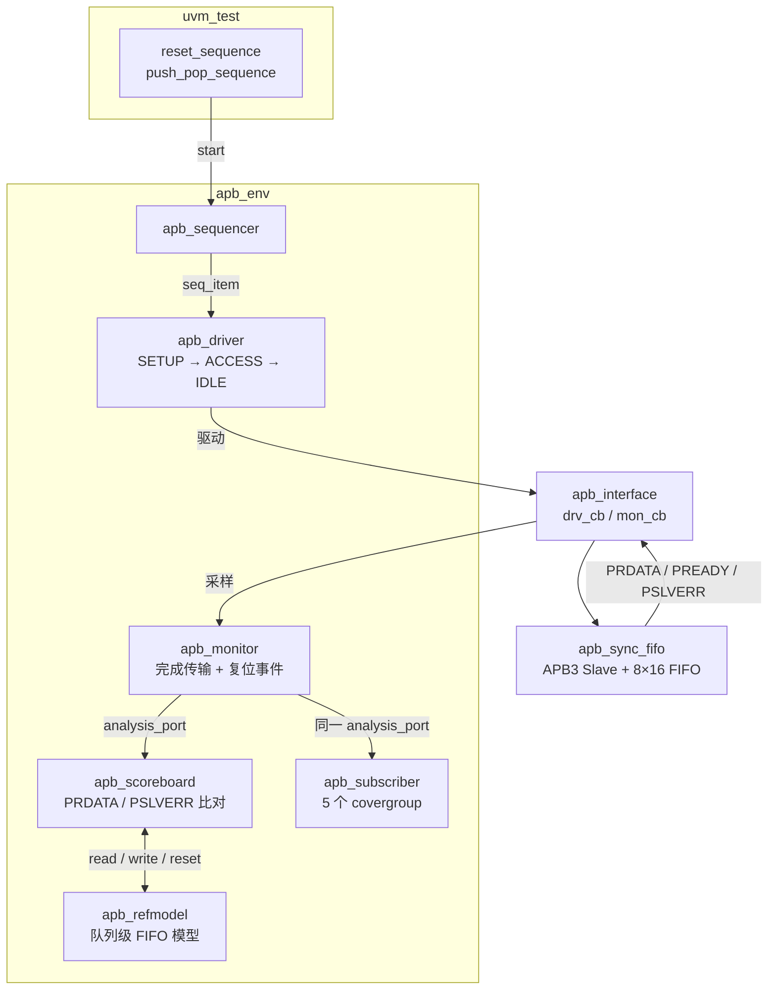

# APB3 FIFO UVM 验证环境

> **30 秒摘要**：用一个「带 5 个 RTL bug」的 APB3 FIFO 做完整 UVM 验证。项目不仅仅把测试跑通，而且**证明环境有能力发现错误**：5 个 RTL bug 全部由 scoreboard 自动比对捕获，并逐条定位到根因；另外还记录了 2 个 TB 自身的典型坑。
>
> 关键词：`SystemVerilog` · `UVM 1.2` · `APB3` · `FIFO` · `参考模型` · `功能覆盖率` · `Debug`
>
> **能力关键词**：UVM 全链路 · APB3 协议 · 参考模型与比对 · 覆盖率建模 · Bug 定位

<p>
  
  
  
  
  
</p>

[GitHub 仓库](https://github.com/K-BreezeMu/APB_FIFO) · [验证架构](#验证架构) · [5 个 RTL Bug](#如何证明环境有效5-个-rtl-bug) · [测试与覆盖率](#测试与覆盖率) · [快速开始](#快速开始)

---

## 项目名片

| 项目 | 内容 |
| --- | --- |
| 项目类型 | 数字 IC 验证个人项目 / UVM 全链路实战 |
| 项目时间 | 2026.10 |
| 我的角色 | 负责 UVM 环境搭建、测试用例、参考模型、覆盖率与 Debug |
| 待测设计 | `apb_sync_fifo`：8-bit × 16 depth 同步 FIFO，APB3 Slave 接口，4 个寄存器 |
| 验证方法 | UVM 1.2、定向测试、带权随机、队列级参考模型、scoreboard、covergroup |
| 代码规模 | 约 **960 行验证代码**，18 个 SystemVerilog 文件 |
| 仿真工具 | Synopsys VCS / QuestaSim（两套脚本），Verdi 波形 |
| 项目产出 | 5 个 RTL bug + 2 个 TB bug 的定位记录、验证报告、覆盖率报告 |

---

## 先看结果

| 指标 | 结果 |
| --- | --- |
| RTL Bug | **5 个**，全部由 scoreboard mismatch 自动捕获 |
| TB Bug | **2 个**：复位采样竞争、driver 非阻塞赋值 |
| 功能覆盖率 | `Transaction` 100% · `ctrl_cg` 100% · `data_cg` 100% · `thresh_cg` 100% · `status_cg` 97.96% |
| 测试用例 | 复位测试 + push/pop 测试；push/pop 覆盖 8 类场景与 100 轮带权随机 |
| 复现方式 | VCS / QuestaSim 双流程；仓库保留含 bug 的 DUT，mismatch 属预期 |


> 覆盖率截图来自含 bug 的 DUT 版本；`FALL` 即 fail 计数，非 0 是预期结果，正好对应下面记录的 5 个 RTL bug。

---

## 工程亮点

| 亮点 | 我做了什么 | 体现的能力 |
| --- | --- | --- |
| **用 Bug 证明环境有效** | 不是满足于「test passed」，而是用 scoreboard 抓出 5 个 RTL bug，并逐条定位到代码根因 | 验证思维、Debug 深度、环境可信度 |
| **完整 UVM 全链路** | interface / sequence item / sequencer / driver / monitor / refmodel / scoreboard / subscriber / env / test 全部自己搭 | UVM 组件职责、TLM、phase、config_db |
| **独立参考模型** | 用 SV 队列按 spec 重写 FIFO 语义，不复用 DUT 代码，避免「用同一份错误逻辑验证自己」 | 参考模型独立实现、spec 理解 |
| **复位是一等公民** | monitor 把复位也打包成一笔特殊事务广播，scoreboard 收到后同步 reset refmodel | 复位验证、状态一致性 |
| **单 Monitor 双订阅** | 一个 analysis port 同时驱动 scoreboard 和 coverage collector，检查与覆盖率互不干扰 | TLM 广播、组件解耦 |
| **覆盖率驱动** | 5 个 covergroup，覆盖读写 × 地址 cross、数据值域、状态位、控制位、阈值 | 覆盖率建模、收敛策略 |
| **工程化与文档** | Makefile / QuestaSim 脚本、Bug 追踪表、验证报告、复现说明 | 脚本化、可复现、技术写作 |

---

## 我掌握的能力

| 能力维度 | 对应实践 |
| --- | --- |
| **UVM 方法学** | 独立搭建 agent / env / sequence / sequencer / driver / monitor / scoreboard / subscriber；理解 analysis port、config_db、objection、report_phase |
| **APB3 协议** | 熟悉 SETUP → ACCESS 两阶段传输、`PSEL/PENABLE/PREADY` 握手、`PREADY` 等待、`PSLVERR` 错误响应 |
| **参考模型与比对** | 用队列建模 FIFO 的 push/pop、阈值、粘滞标志；scoreboard 比对 `PRDATA` 与 `PSLVERR`，mismatch 按字段打印 |
| **功能覆盖率** | 设计 5 个 covergroup，包含 `pwrite × paddr` cross、数据值域、状态位、控制位、阈值 |
| **Debug 能力** | 从 mismatch 现象反查 RTL 根因；定位复位敏感列表、满标志 off-by-one、粘滞性、空读、`PSLVERR` 等问题 |
| **验证计划** | 把 reset、push/pop、边界、上溢/下溢、clear、阈值、drop_on_full、随机 8 类场景拆成可执行用例 |
| **工程化** | VCS / QuestaSim 双流程、Makefile、Verdi、Git、验证报告与 Bug 追踪文档 |

---

## 验证架构



**一句话数据流**：sequence 产生 APB 读写 → driver 完成 SETUP/ACCESS 握手 → monitor 在 `PSEL & PENABLE & PREADY` 时采样 → scoreboard 更新/查询 refmodel 并比对 → subscriber 同步采样覆盖率。

### 组件职责

| 组件 | 关键文件 | 职责 |
| --- | --- | --- |
| `apb_interface` | [`apb_interface.sv`](https://github.com/K-BreezeMu/APB_FIFO/blob/main/component/apb_interface.sv) | 声明 APB 信号，提供 `drv_cb` / `mon_cb` 两个 clocking block，隔离驱动与采样 |
| `apb_sequence_item` | [`apb_sequence_item.sv`](https://github.com/K-BreezeMu/APB_FIFO/blob/main/component/apb_sequence_item.sv) | 事务对象；`paddr` 约束在 4 个合法寄存器，`pwdata` 按寄存器位宽约束 |
| `apb_sequencer` | [`apb_sequencer.sv`](https://github.com/K-BreezeMu/APB_FIFO/blob/main/component/apb_sequencer.sv) | 标准 UVM sequencer |
| `apb_driver` | [`apb_driver.sv`](https://github.com/K-BreezeMu/APB_FIFO/blob/main/component/apb_driver.sv) | 实现 SETUP → ACCESS → IDLE；包含标准 `PREADY` 等待循环；回填 `prdata/pslverr` |
| `apb_monitor` | [`apb_monitor.sv`](https://github.com/K-BreezeMu/APB_FIFO/blob/main/component/apb_monitor.sv) | 在完成传输时采样；把复位也作为特殊事务广播 |
| `apb_refmodel` | [`apb_refmodel.sv`](https://github.com/K-BreezeMu/APB_FIFO/blob/main/component/apb_refmodel.sv) | 用 `bit[7:0] data[$]` 建模 FIFO，独立实现 push/pop、阈值、粘滞标志 |
| `apb_scoreboard` | [`apb_scoreboard.sv`](https://github.com/K-BreezeMu/APB_FIFO/blob/main/component/apb_scoreboard.sv) | 读操作比对 `PRDATA`；写 `DATA` 时比对 `PSLVERR`；mismatch 按字段打印 |
| `apb_subscriber` | [`apb_subscriber.sv`](https://github.com/K-BreezeMu/APB_FIFO/blob/main/component/apb_subscriber.sv) | 5 个 covergroup，`report_phase` 打印覆盖率 |
| `apb_env` | [`apb_env.sv`](https://github.com/K-BreezeMu/APB_FIFO/blob/main/component/apb_env.sv) | 例化 agent/scoreboard/subscriber，连接 analysis port 到两个订阅者 |
| `tb_top` | [`tb_top.sv`](https://github.com/K-BreezeMu/APB_FIFO/blob/main/component/tb_top.sv) | 时钟、接口、DUT 例化、`uvm_config_db` 传 vif、1 ms 看门狗 |

---

## DUT 规格与寄存器

### 基本规格

| 参数 | 取值 | 说明 |
| --- | --- | --- |
| FIFO 位宽 | 8 bit | `WIDTH = 8` |
| FIFO 深度 | 16 entry | `DEPTH = 16` |
| 总线位宽 | 32 bit | APB `PWDATA` / `PRDATA` |
| 总线协议 | APB3 | 两周期 SETUP / ACCESS |
| `PREADY` | 固定 1 | DUT 零等待；driver 仍保留标准等待逻辑 |
| 寄存器 | 4 个 | CTRL / THRESH / STATUS / DATA |

### 寄存器映射

| 地址 | 名称 | 属性 | 位域 |
| --- | --- | --- | --- |
| `0x00` | `CTRL` | RW | `[0] en`，`[1] clr`（自清），`[2] drop_on_full` |
| `0x04` | `THRESH` | RW | `[7:0] almost_full_th`（默认 15），`[15:8] almost_empty_th`（默认 1） |
| `0x08` | `STATUS` | RO | `empty/full/almost_*/overflow/underflow/count` |
| `0x0C` | `DATA` | RW | 写 = push，读 = pop |

`STATUS` 位域：

| 位 | 名称 | 含义 |
| --- | --- | --- |
| `[0]` | `empty` | 空标志 |
| `[1]` | `full` | 满标志 |
| `[2]` | `almost_full` | `count > almost_full_th` |
| `[3]` | `almost_empty` | `count <= almost_empty_th` |
| `[4]` | `overflow` | 上溢，设计意图为粘滞 |
| `[5]` | `underflow` | 下溢，设计意图为粘滞 |
| `[13:6]` | `count` | 当前元素个数（0 ~ 16） |

### 关键行为语义

- `en = 0` 时 FIFO 冻结，push / pop 均被忽略；
- `clr = 1` 同步清空 FIFO，`count`、指针、标志全部复位，该位自清；
- `drop_on_full = 1` 时写满静默丢弃新数据，但仍应上报 `PSLVERR`；
- 空读应返回 `0`，置 `underflow`，并拉高 `PSLVERR`；
- `overflow` / `underflow` 设计意图为粘滞，不应被一次 `STATUS` 读清零。

---

## 如何证明环境有效：5 个 RTL Bug

> 这 5 个 bug 均由 scoreboard mismatch 触发，根因直接对应 [`dut/fifo.sv`](https://github.com/K-BreezeMu/APB_FIFO/blob/main/dut/fifo.sv) 中的代码。仓库保留含 bug 版本，方便复现。

| ID | 现象 | 根因 | 类型 |
| --- | --- | --- | --- |
| **BUG-01** | 复位释放后 `count` 恒为 0，pop 永远读到 `0x00`，FIFO 像「死」了一样 | 计数/标志块的敏感列表写成 `always @(posedge PCLK or posedge PRESETn)`，异步复位沿极性写反；复位释放的上升沿被误当成复位触发 | RTL |
| **BUG-02** | 写入第 15 笔时就报 `full`，第 16 笔被丢弃；但 `almost_full` 正常 | 满标志判据写成 `full <= (count == DEPTH-1)`，应为 `count == DEPTH`，off-by-one | RTL |
| **BUG-03** | `overflow` / `underflow` 置位后，只要读一次 `STATUS` 就归零，粘滞性丢失 | 读访问分支里加了 `overflow <= 0; underflow <= 0;`，把「读状态」实现成了「读清」 | RTL |
| **BUG-04** | 空 FIFO 执行 pop 返回上一次的残留数据（如 `0x0a`），而不是 0 | `PRDATA` 直接取 `mem[rptr]`，未判 `empty`；`underflow` 与返回值语义不一致 | RTL |
| **BUG-05** | `drop_on_full` 场景下 `PSLVERR` 恒为 0，错误路径完全不可观测 | `assign PSLVERR = 1'b0;`，错误响应未实现 | RTL |

### 从 mismatch 到根因：一个真实例子

以 BUG-02 为例，scoreboard 不只是打印「错了」，而是把 `STATUS` 按字段拆开：

```text
0x08 Mismatch: exp = 0x000003c0, act = 0x000003c2
Full         : exp = 0, act = 1
count        : exp = 15, act = 15
```

`count` 一致但 `full` 不一致，说明问题不在计数逻辑，而在满标志的比较阈值。顺着这条线索看 RTL，就能锁定 `DEPTH-1` 这个 off-by-one。这种「按字段打印期望值/实际值」的设计，把 debug 从「猜」变成了「顺着差异定位」。

---

## 两个 TB 自身的坑

除了 RTL bug，环境本身也踩过两个典型问题。把它们写出来，是因为**验证工程师不仅要会找 DUT 的错，也要能修自己平台的错**。

### TB-01：复位时刻的采样竞争

- **现象**：monitor 与 scoreboard 在同一时刻响应复位事件，monitor 检测到复位后立刻采样并广播，导致 scoreboard 处理「复位」这笔事务时跑到了 refmodel 前面，复位后的第一笔比对出现假 fail。
- **定位**：复位路径上 monitor → scoreboard → refmodel 的更新顺序没有对齐，采样早于状态更新。
- **修复**：在 monitor 采样复位事件前插入 `#0`，让 DUT / refmodel 的状态先稳定，再比对。
- **收获**：理解了 clocking block 采样、delta cycle 和 reset 事件顺序对 scoreboard 的影响。

### TB-02：driver 里的非阻塞赋值

- **现象**：读操作拿到的 `act` 恒为 0。
- **根因**：driver 回填事务字段时误用了非阻塞赋值 `<=`。此时赋的是 sequence item 里的值（软件侧对象），不是 RTL 的采样值；非阻塞语义让赋值推迟一拍，采样点已经错过。
- **修复**：改成阻塞赋值 `=`，事务字段立即生效。
- **收获**：分清「RTL 时序逻辑用非阻塞」和「TB 事务字段赋值用阻塞」的边界。

---

## 测试与覆盖率

### 测试矩阵

| 测试 | 场景 | 检查点 |
| --- | --- | --- |
| `reset_sequence_test` | 上电复位 | 复位后 `STATUS` 应为 `empty=1`、`count=0` |
| | 空闲态复位 | 无 outstanding 传输时复位不影响后续访问 |
| | Push 后复位 | 写入 1 笔后复位，`count` 归零、`empty=1` |
| `push_pop_sequence_test` | 进一出一 | 单笔 push 后 `count` 递增，pop 顺序正确 |
| | 连续进 / 连续出 | 4 笔连续 push 后连续 pop，数据顺序与计数正确 |
| | 接近满 / 接近空 | push 15 笔、pop 14 笔，检查 `almost_full/almost_empty` 翻转点 |
| | 上溢 / 下溢 + 粘滞性 | 空读、写满后再写，检查 `overflow/underflow` 置位并保持 |
| | Clear 功能 | 写满后置 `CTRL[1]=1`，`count` 清零且 `clr` 自清 |
| | 阈值修改后边界 | 改写 `THRESH = {ae=4, af=10}` 后重新扫描边界 |
| | `drop_on_full` | 分别置 0/1 后写满，检查丢弃行为与错误上报 |
| | 带权随机 | 100 轮，30% 改阈值、30% pop，数据按 0x00/0xFF/低/中/高加权 |

### 覆盖率模型

| covergroup | 覆盖内容 |
| --- | --- |
| `cg_transaction` | `pwrite × paddr` cross，排除对 `STATUS` 的写 |
| `data_cg` | 写数据 / 读数据各 5 个值域 bin：zero / low / mid / high / max |
| `status_cg` | `count` 7 个区间 bin + `empty/full/almost_*/overflow/underflow` |
| `ctrl_cg` | `en` / `clr` / `drop_on_full` 的取值覆盖 |
| `thresh_cg` | `almost_full_th` / `almost_empty_th` 的值域 bin |

### 结果

- 4 个 covergroup 达到 **100%**，`status_cg` 达到 **97.96%**；
- 5 个 RTL bug 全部由 scoreboard 自动比对定位，每一条都能按「现象 → 根因」复现；
- 由于仓库中的 DUT 保留含 bug 版本，仿真出现 mismatch 是**预期结果**，不是环境坏了；
- 把 DUT 修复后重跑 `make run_all`，`FALL` 应清零——这既是回归，也是环境有效性的反向证明。

---

## 项目结构

```text
APB_FIFO/
├── dut/
│   └── fifo.sv                    # DUT：APB3 同步 FIFO（含待验证 bug）
├── component/                     # 验证环境（全部 include 进 apb_pkg）
│   ├── apb_pkg.sv                 # package：参数、寄存器地址、include 顺序
│   ├── apb_interface.sv           # 接口 + drv_cb / mon_cb
│   ├── apb_sequence_item.sv       # 事务 + 地址/位宽约束
│   ├── apb_sequencer.sv
│   ├── apb_driver.sv              # APB3 三段式驱动
│   ├── apb_monitor.sv             # 事务采样 + 复位事件广播
│   ├── apb_agent.sv
│   ├── apb_refmodel.sv            # 队列级参考模型
│   ├── apb_scoreboard.sv          # 自动比对 + 字段级错误定位
│   ├── apb_subscriber.sv          # 5 个 covergroup
│   ├── apb_env.sv
│   └── tb_top.sv
├── sequence_test/
│   ├── base_sequence.sv           # write / read / reset / enable 基础操作
│   ├── base_sequence_test.sv      # 测试基类
│   ├── reset_sequence.sv          # 复位场景
│   ├── reset_sequence_test.sv
│   ├── push_pop_sequence.sv       # 8 组 push/pop 场景
│   └── push_pop_sequence_test.sv
├── makefile                       # VCS 流程
├── run.sh                         # QuestaSim 流程
├── Lab_Project-v2.pdf             # 原始实验说明
└── report.docx                    # 验证报告（含完整调试记录）
```

---

## 快速开始

### 依赖

- SystemVerilog 仿真器：VCS（`-ntb_opts uvm-1.2`）或 QuestaSim（UVM 1.2 库）
- UVM 1.2
- 可选：Verdi（`make verdi` 看波形）或 Questa GUI

### VCS 流程

```bash
# 编译
make compile

# 跑单个测试
make run TEST=reset_sequence_test
make run TEST=push_pop_sequence_test

# 跑全部测试
make run_all

# 带波形运行
make run TEST=push_pop_sequence_test DUMP=1
make verdi

# 清理
make clean
```

### QuestaSim 流程

```bash
# 先修改 run.sh 里的 ROOT 为你的仓库路径
bash run.sh
```

> `run.sh` 中的 `ROOT` 目前是作者本机路径，克隆后请改为你的仓库根目录。

### 预期现象

由于仓库中的 DUT 仍带着 bug，仿真结束时 `FALL` 不为 0 属正常。每笔失败会按字段打印期望值与实际值，例如：

```text
0x08 Mismatch: exp = 0x000003c0, act = 0x000003c2
Full         : exp = 0, act = 1
count        : exp = 15, act = 15
```

---

