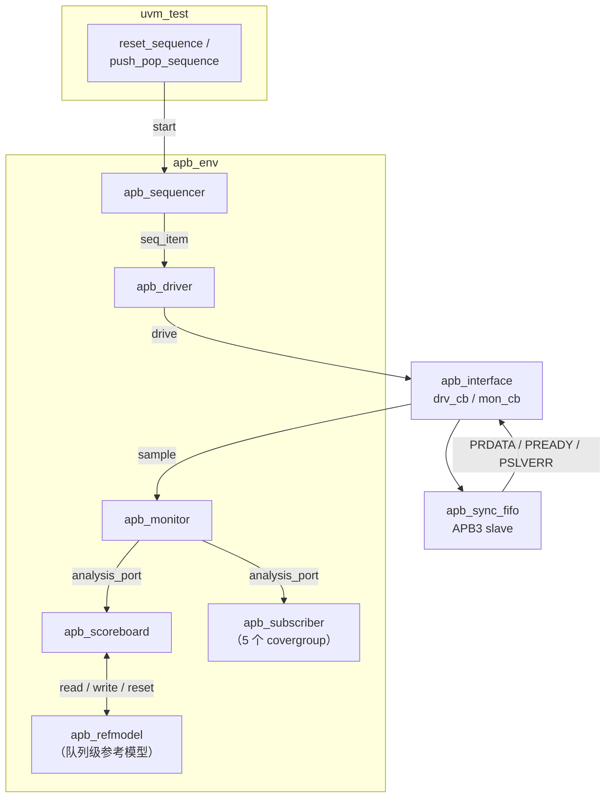

# APB_FIFO — UVM 验证环境

> 一个带 APB3 从机接口的同步 FIFO（8-bit × 16 depth）的完整 UVM 验证环境。
> 从零搭建 agent / scoreboard / reference model / coverage，用定向 + 随机用例把 DUT 里的 **5 个 RTL bug** 全部抓了出来。


---

## 目录

- [项目简介](#项目简介)
- [DUT 规格](#dut-规格)
- [验证架构](#验证架构)
- [目录结构](#目录结构)
- [快速开始](#快速开始)
- [测试用例](#测试用例)
- [覆盖率模型](#覆盖率模型)
- [Bug 追踪](#bug-追踪)
- [验证过程中的两个 TB 坑](#验证过程中的两个-tb-坑)
- [验证结论](#验证结论)
- [已知限制与后续计划](#已知限制与后续计划)
- [参考资料](#参考资料)

---

## 项目简介

这是一个**同步 FIFO 的功能验证项目**：DUT 通过 APB3 从机接口暴露 4 个寄存器（控制、阈值、状态、数据），验证环境基于 UVM 1.2 搭建，采用「**激励分层 + 参考模型自动比对 + 功能覆盖率驱动**」的经典结构。

项目的重点不是"把测试跑通"，而是**证明环境有能力发现 RTL 的错**：

| 维度 | 内容 |
| --- | --- |
| 验证方法学 | UVM 1.2（`uvm_agent` / `uvm_scoreboard` / `uvm_subscriber`） |
| 总线协议 | APB3，两周期 SETUP / ACCESS 传输，零等待（`PREADY` 恒 1） |
| 激励方式 | 定向用例（复位、边界、上溢下溢、粘滞性）+ 带权随机 |
| 检查手段 | 队列级 reference model 逐拍比对 `PRDATA` / `PSLVERR` |
| 覆盖率 | 5 个 covergroup，含读写 × 地址 cross |
| 产出 | 5 个 RTL bug + 2 个 TB 自身 bug 的定位记录 |

> **关于仓库里的 DUT**
> [`dut/fifo.sv`](dut/fifo.sv) 保留的是**含 bug 的原始版本**（文件头即注明 `intentionally buggy`），方便复现问题。所以直接跑测试会看到 scoreboard 报 mismatch —— **这是预期结果，不是环境坏了**。每条 mismatch 都能在 [Bug 追踪](#bug-追踪) 里找到对应的根因。

---

## DUT 规格

### 参数

| 参数 | 取值 | 说明 |
| --- | --- | --- |
| `WIDTH` | 8 bit | 数据位宽 |
| `DEPTH` | 16 entry | FIFO 深度 |
| 总线位宽 | 32 bit | APB `PWDATA` / `PRDATA` |
| 寄存器 | 4 个 | 见下表 |

### 寄存器映射

| 地址 | 名称 | 属性 | 位域 |
| --- | --- | --- | --- |
| `0x00` | `CTRL` | RW | `[0]` en，`[1]` clr（自清），`[2]` drop_on_full |
| `0x04` | `THRESH` | RW | `[7:0]` almost_full_th（默认 15），`[15:8]` almost_empty_th（默认 1） |
| `0x08` | `STATUS` | RO | 见下方位域表 |
| `0x0C` | `DATA` | RW | 写 = push，读 = pop |

`STATUS`（`0x08`）位域：

| 位 | 名称 | 含义 |
| --- | --- | --- |
| `[0]` | `empty` | 空标志 |
| `[1]` | `full` | 满标志 |
| `[2]` | `almost_full` | `count > almost_full_th` |
| `[3]` | `almost_empty` | `count <= almost_empty_th` |
| `[4]` | `overflow` | 上溢，**设计意图为粘滞** |
| `[5]` | `underflow` | 下溢，**设计意图为粘滞** |
| `[13:6]` | `count` | 当前元素个数（0 ~ 16） |

### 行为语义

- **en = 0** 时，FIFO 冻结，push / pop 均被忽略。
- **clr = 1**：同步清空 FIFO（`count` / 指针 / 标志全部复位），该位自清。
- **drop_on_full = 1**：写满时静默丢弃新数据（仍应上报 `PSLVERR`）；为 0 时写满应返回错误。
- **空读**：应返回 `0` 并置 `underflow`、拉高 `PSLVERR`。
- `PREADY` 恒为 1，即零等待状态；`PSLVERR` 应由 DUT 按上述规则产生。

### APB3 时序

APB3 是两阶段传输协议，一笔写入固定经过 `IDLE → SETUP → ACCESS`：

| 阶段 | `PSEL` | `PENABLE` | 总线行为 |
| --- | --- | --- | --- |
| IDLE | 0 | 0 | 空闲，无传输 |
| SETUP | 1 | 0 | `PADDR` / `PWRITE` / `PWDATA` 建立，从机可拉低 `PREADY` 插入等待 |
| ACCESS | 1 | 1 | `PENABLE` 拉高；`PREADY=1` 的当拍完成传输，读数据 `PRDATA` 与 `PSLVERR` 同时有效 |

本 DUT 的 `PREADY` 恒为 1，即**零等待**：每笔访问固定占 2 个时钟周期（SETUP 1 拍 + ACCESS 1 拍），验证环境无需处理 wait state。

---

## 验证架构



### 组件职责

| 组件 | 文件 | 职责 |
| --- | --- | --- |
| `apb_interface` | [`component/apb_interface.sv`](component/apb_interface.sv) | 声明 APB 信号，提供 `drv_cb`（驱动）与 `mon_cb`（采样）两个 clocking block，隔离驱动与采样时序 |
| `apb_sequence_item` | [`component/apb_sequence_item.sv`](component/apb_sequence_item.sv) | 事务对象，`paddr` 约束在 4 个合法地址内，并按寄存器位宽约束 `pwdata` 高位为 0 |
| `apb_driver` | [`component/apb_driver.sv`](component/apb_driver.sv) | 实现 SETUP → ACCESS → IDLE 三段式握手，等待 `PREADY`，回填 `prdata` / `pslverr` |
| `apb_monitor` | [`component/apb_monitor.sv`](component/apb_monitor.sv) | 在 `PSEL & PENABLE & PREADY` 时采样一笔完成的事务，同时把复位事件作为特殊事务广播 |
| `apb_refmodel` | [`component/apb_refmodel.sv`](component/apb_refmodel.sv) | 用 SV 队列 `bit[7:0] data[$]` 建模 FIFO，独立实现 push / pop / 阈值 / 粘滞标志，作为比对基准 |
| `apb_scoreboard` | [`component/apb_scoreboard.sv`](component/apb_scoreboard.sv) | 读操作比对 `PRDATA`；写 `DATA` 时比对 `PSLVERR`；mismatch 时按字段逐位打印期望值/实际值 |
| `apb_subscriber` | [`component/apb_subscriber.sv`](component/apb_subscriber.sv) | 挂载 5 个 covergroup 收集功能覆盖率，`report_phase` 打印各项覆盖率 |
| `apb_env` | [`component/apb_env.sv`](component/apb_env.sv) | 例化 agent / scoreboard / subscriber，连接 analysis port 到两个订阅者 |
| `tb_top` | [`component/tb_top.sv`](component/tb_top.sv) | 时钟、接口、DUT 例化、`uvm_config_db` 传递 vif、1 ms 看门狗 |

**设计要点**

- **参考模型独立实现**：refmodel 不复用 DUT 代码，直接按 spec 用队列语义重写，避免"用同一份错误逻辑验证自己"。
- **单 monitor 双订阅**：一个 `analysis_port` 同时驱动 scoreboard 和 coverage collector，检查与覆盖率互不干扰。
- **复位是一等公民**：monitor 把 `PRESETn` 拉低也打包成一笔事务，scoreboard 收到后调用 `refmodel.reset()`，保证复位后两侧状态同步归零。

---

## 目录结构

```
APB_FIFO/
├── dut/
│   └── fifo.sv                    # DUT：APB3 同步 FIFO（含待验证的 bug）
├── component/                     # 验证环境（全部 include 进 apb_pkg）
│   ├── apb_pkg.sv                 # package：参数、寄存器地址、include 顺序
│   ├── apb_interface.sv           # 接口 + drv_cb / mon_cb
│   ├── apb_sequence_item.sv       # 事务 + 地址/位宽约束
│   ├── apb_sequencer.sv           # sequencer
│   ├── apb_driver.sv              # APB3 三段式驱动
│   ├── apb_monitor.sv             # 事务采样 + 复位事件广播
│   ├── apb_agent.sv               # active agent 封装
│   ├── apb_refmodel.sv            # 队列级参考模型
│   ├── apb_scoreboard.sv          # 自动比对 + 错误定位打印
│   ├── apb_subscriber.sv          # 5 个 covergroup
│   ├── apb_env.sv                 # 环境顶层
│   └── tb_top.sv                  # 时钟 / DUT / run_test
├── sequence_test/
│   ├── base_sequence.sv           # write / read / reset / enable 等基础操作
│   ├── base_sequence_test.sv      # 测试基类，例化 env
│   ├── reset_sequence.sv          # 复位场景
│   ├── reset_sequence_test.sv
│   ├── push_pop_sequence.sv       # 8 组 push/pop 场景
│   └── push_pop_sequence_test.sv
├── makefile                       # VCS 流程：compile / run / run_all / verdi
├── run.sh                         # QuestaSim 流程：vlog / vopt / vsim
├── Lab_Project-v2.pdf             # 原始实验说明
└── report.docx                    # 验证报告（含完整调试记录）
```

---

## 快速开始

### 依赖

- SystemVerilog 仿真器：**VCS**（`-ntb_opts uvm-1.2`）或 **QuestaSim**（预编译 UVM 库 `mtiUvm=uvm-1.2`）
- UVM 1.2
- 可选：Verdi（`make verdi` 看波形）或 Questa GUI

### VCS 流程

```bash
# 编译
make compile

# 跑单个测试（默认 reset_sequence_test）
make run TEST=push_pop_sequence_test

# 跑全部测试
make run_all

# 带波形选项运行（DUMP=1 时追加 +fsdb）
make run TEST=push_pop_sequence_test DUMP=1

# 用 Verdi 打开波形
make verdi

# 清理
make clean
```

`makefile` 用 `wildcard` / `find` 自动收集 `.sv`，新增文件不需要改编译列表。

### QuestaSim 流程

```bash
# 先按本机环境修改 run.sh 里的 ROOT 路径和 PATH
bash run.sh
```

> `run.sh` 里的 `ROOT="D:/ROAD/learn/apb_fifo"` 是作者本机路径，克隆后**必须改成自己的仓库路径**。

### 预期输出

仿真结束时 `report_phase` 会打印 scoreboard 统计与覆盖率（下面是**格式示意，数字以实际仿真为准**）：

```
-----------------Report SCB----------------------
total :      —
PASS  :      —
FALL  :      —
-------------------------------------------------
----------------Report--------------
Transaction :      —%
ctrl_cg     :      —%
status_cg   :      —%
data_cg     :      —%
thresh_cg   :      —%
------------------------------------
```

因为仓库里的 DUT 仍带着 bug，`FALL` 不为 0 属正常（源码里 `FALL` 即 fail 计数）；每笔失败会按字段打印期望值与实际值，例如写满第 15 笔后读 `STATUS`：

```
0x08 Mismatch:exp =0x000003c0,act =0x000003c2
Empty        : exp = 0,act = 0
Full         : exp = 0,act = 1
almost_full  : exp = 0,act = 0
almost_empty : exp = 0,act = 0
overflow     : exp = 0,act = 0
underflow    : exp = 0,act = 0
count        : exp = 15,act = 15
```

---

## 测试用例

### `reset_sequence_test` — 复位

| # | 场景 | 检查点 |
| --- | --- | --- |
| 1 | 上电复位 | 复位后 `STATUS` 应为 `empty=1`、`count=0` |
| 2 | 空闲态复位 | 无 outstanding 传输时复位不影响后续访问 |
| 3 | Push 后复位 | 已写入 1 笔数据后复位，`count` 应归零、`empty` 应为 1 |

### `push_pop_sequence_test` — 读写与边界

| # | 场景 | 检查点 |
| --- | --- | --- |
| 1 | 进一出一 | 单笔 push 后 `count` 递增，pop 顺序正确（FIFO 序） |
| 2 | 连续进入 / 连续出来 | 4 笔连续 push 后连续 pop，数据顺序与计数正确 |
| 3 | 接近满 / 接近空 | push 15 笔、pop 14 笔，检查 `almost_full` / `almost_empty` 翻转点 |
| 4 | 上溢 / 下溢 + 粘滞性 | 空读、写满后再写，检查 `overflow` / `underflow` 置位且在后续操作中保持 |
| 5 | Clear 功能 | 写满后置 `CTRL[1]=1`，`count` 应清零且 `clr` 自清 |
| 6 | 阈值修改后边界 | 改写 `THRESH = {ae=4, af=10}` 后重新扫描边界 |
| 7 | `drop_on_full` | 分别置 0 / 1 后写满，检查丢弃行为与错误上报 |
| 8 | 带权随机 | 100 轮，30% 概率改阈值、30% 概率 pop，数据按 0x00 / 0xFF / 低 / 中 / 高 加权 |

覆盖率 bin 的分布与随机分布权重是对齐的（见 `data_cg` 与 `push_pop_sequence` 里的 `dist`），便于快速收敛。

---

## 覆盖率模型

| covergroup | 覆盖内容 |
| --- | --- |
| `cg_transaction` | `pwrite` × `paddr` cross（排除对 `STATUS` 的写） |
| `data_cg` | 写数据 / 读数据各 5 个值域 bin：zero / low / mid / high / max |
| `status_cg` | `count` 7 个区间 bin + `empty` / `full` / `almost_*` / `overflow` / `underflow` |
| `ctrl_cg` | `en` / `clr` / `drop_on_full` 的取值覆盖 |
| `thresh_cg` | `almost_full_th` / `almost_empty_th` 的值域 bin |

覆盖率在 `apb_subscriber::report_phase` 中打印；如需合并多测试的覆盖率，可在仿真器侧导出 UCDB / VDB 后 merge。

---

## Bug 追踪

> 下面 5 个是 RTL 侧的真实缺陷，均由本环境通过 scoreboard mismatch 定位；根因直接对应 [`dut/fifo.sv`](dut/fifo.sv) 中的代码。

| ID | 现象 | 根因 | 类型 |
| --- | --- | --- | --- |
| **BUG-01** | 复位释放后 `count` 恒为 0，pop 永远读到 `0x00`，FIFO 像"死"了一样 | 计数/标志块的敏感列表写成了 `always @(posedge PCLK or posedge PRESETn)`，异步复位沿极性写反（另一块用的是 `negedge`），复位释放的上升沿被误当成复位触发，状态停在复位值 | RTL |
| **BUG-02** | 写入第 15 笔时就报 `full`，第 16 笔被丢弃；但 `almost_full` 正常 | 满标志判据写成 `full <= (count == DEPTH-1)`，应为 `count == DEPTH`，off-by-one | RTL |
| **BUG-03** | `overflow` / `underflow` 置位后，只要读一次 `STATUS` 就归零，粘滞性丢失 | 读访问分支里加了 `overflow <= 0; underflow <= 0;`，把"读状态"实现成了"读清" | RTL |
| **BUG-04** | 空 FIFO 执行 pop 返回上一次的残留数据（如 `0x0a`），而不是 0 | `PRDATA` 直接取 `mem[rptr]`，未判 `empty`；`underflow` 与返回值语义不一致 | RTL |
| **BUG-05** | `drop_on_full` 场景下 `PSLVERR` 恒为 0，错误路径完全不可观测 | `assign PSLVERR = 1'b0;`，错误响应未实现；scoreboard 的 `compare_pslverr` 因此必然失败 | RTL |

### 从"看到错"到"定位根因"

以 BUG-02 为例，scoreboard 的输出直接指出了错误维度：

```
0x08 Mismatch:exp =0x000003c0,act =0x000003c2
Full   : exp = 0,act = 1
count  : exp = 15,act = 15
```

`count` 一致但 `full` 不一致，说明问题不在计数逻辑，而在满标志的比较阈值 —— 顺着这条线索看 RTL 即可锁定 `DEPTH-1`。

---

## 验证过程中的两个 TB 坑

除了 RTL bug，环境本身也踩过两个典型坑，记录在此供参考。

### TB-01 复位时刻的采样竞争

- **现象**：monitor 与 scoreboard 在同一时刻响应复位事件，monitor 检测到复位后立刻采样并广播，导致 scoreboard 处理"复位"这笔事务时跑到了 refmodel 前面，复位后的第一笔比对出现假 fail；普通事务因为 driver 要等 `psel` 等信号，反而不会触发这个问题。
- **定位**：复位路径上 monitor → scoreboard → refmodel 的更新顺序没有对齐，采样早于状态更新。
- **修复**：在 monitor 采样复位事件前插入延时（`#0`），让 DUT / refmodel 的状态先稳定，再比对。

### TB-02 driver 里的非阻塞赋值

- **现象**：读操作拿到的 `act` 恒为 0。
- **根因**：driver 回填事务字段时误用了非阻塞赋值 `<=`。此时赋的是 sequence item 里的值（软件侧对象），不是 RTL 的采样值，非阻塞语义让赋值推迟一拍，采样点已经错过。
- **修复**：改成阻塞赋值 `=`，事务字段立即生效。

---

## 验证结论

- 两个 test 均能编译、仿真至结束，并正常产出 scoreboard 比对结果与 5 个 covergroup 的覆盖率报告。
- 5 个 RTL bug 全部由 scoreboard 自动比对定位，每一条都能按本文档"现象 → 根因"复现。
- 由于仓库中的 DUT 保留的是含 bug 版本，复位（BUG-01）、满标志（BUG-02）、粘滞性（BUG-03）、空读与 `PSLVERR`（BUG-04 / 05）相关检查会持续报 mismatch；DUT 全部修复后重跑 `make run_all`，`FALL` 应清零 —— 这既是回归，也是环境有效性的反向证明。

---

## 已知限制与后续计划

**协议覆盖**

- DUT 的 `PREADY` 恒为 1，**没有覆盖 wait state 场景**；若要验证插等待的从机，driver 需要支持随机化 `PREADY` 延迟。
- 未覆盖 APB 非法地址访问（`default` 分支）、`PSLVERR` 与 `PREADY` 的并发关系。

**检查完备性**

- 目前以 `PRDATA` / `PSLVERR` 的事务级比对为主，缺少 **SVA 断言**（如"空时不得 pop"、"`count` 不超过 `DEPTH`"、"`overflow` 粘滞"），建议补充断言以缩短 debug 路径。
- 未对 DUT 内部存储做白盒检查（如 `wptr` 回绕、`mem` 内容是否符合预期），目前完全依赖黑盒比对。

**工程化**

- `run.sh` 中硬编码了作者本机路径，建议改为基于脚本所在目录的相对路径（`$(cd "$(dirname "$0")" && pwd)`）。
- `mtiUvm=uvm-1.2/` 是 Questa 编译产生的库目录，建议加入 `.gitignore`（同时忽略 `csrc/`、`simv*`、`*.log`、`*.fsdb`、`ucli.key`、`verdiLog/`）。
- 尚无 CI（可用 GitHub Actions + Verilator 做语法检查，或用开源仿真器跑通子集）。
- 覆盖率数字目前只打印在日志里，建议导出 UCDB / VDB 并纳入仓库或用 CI 归档。

**DUT 侧**

- 仓库保留的是含 bug 版本。修复后可用 `make run_all` 做一次"清零"回归，`FALL` 应为 0，作为环境有效性的反向证明。
